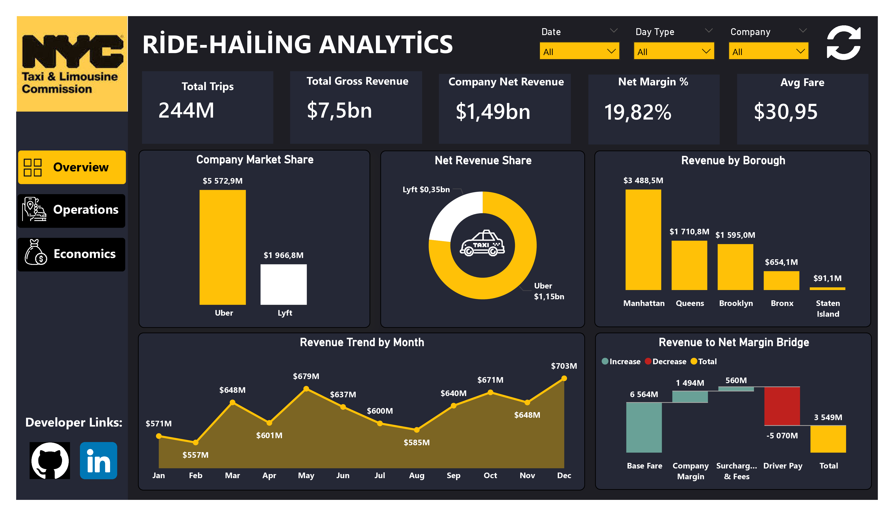
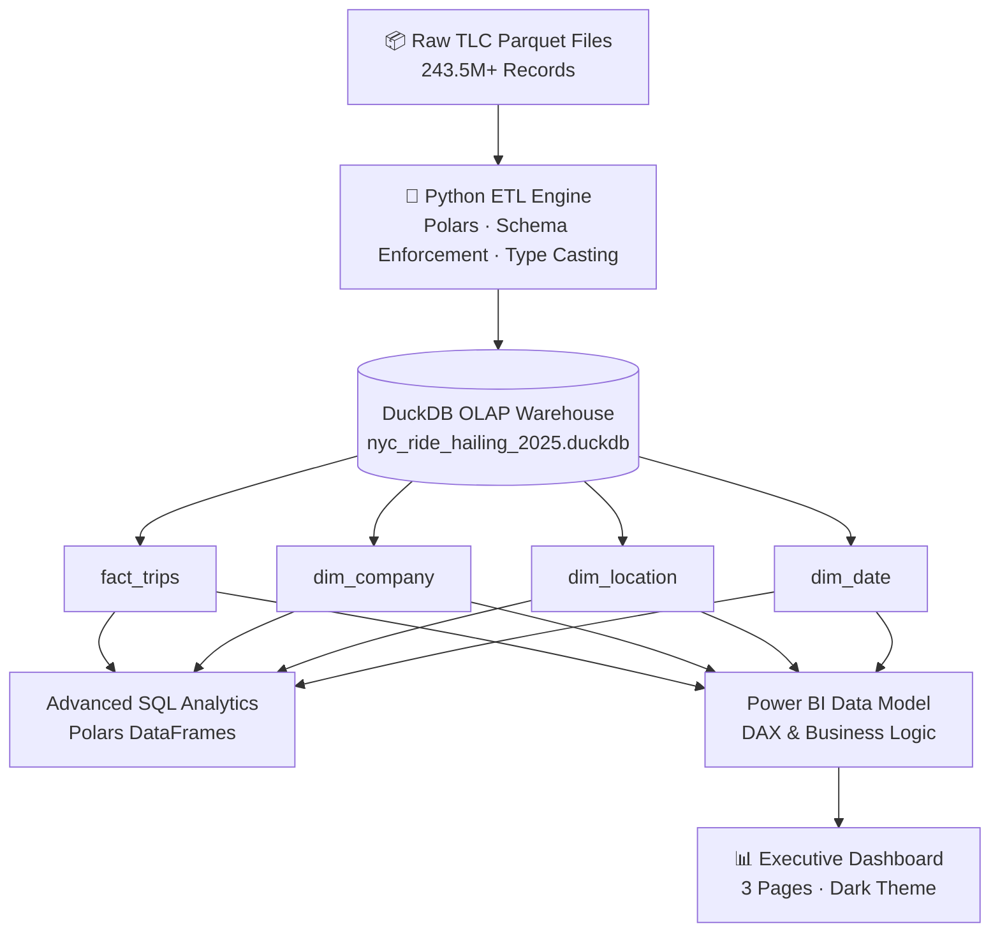
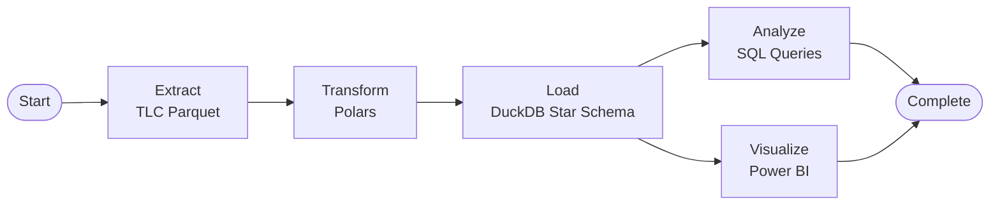
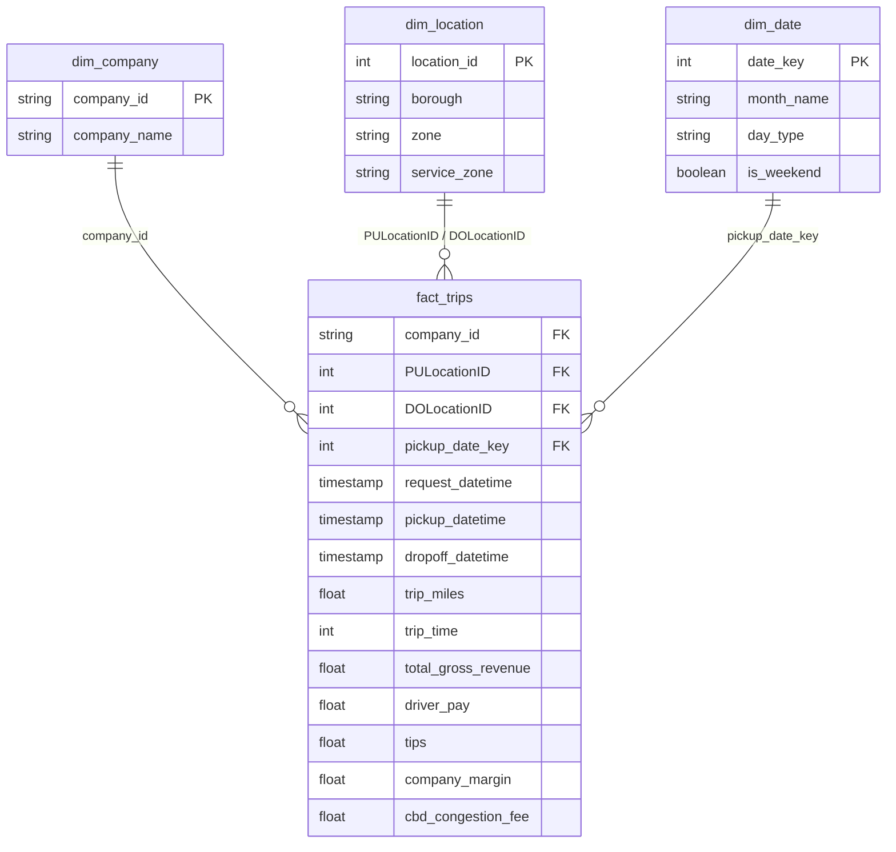
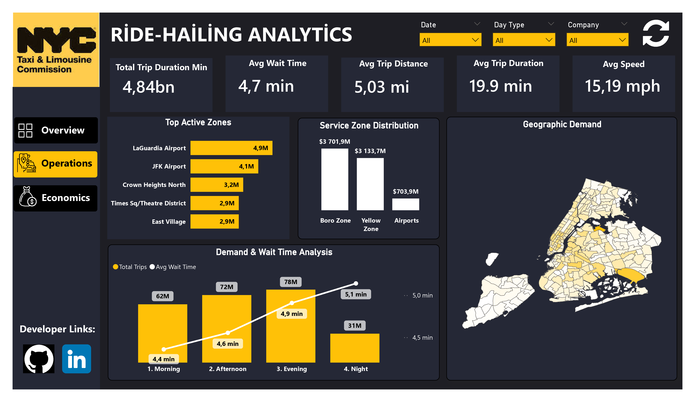
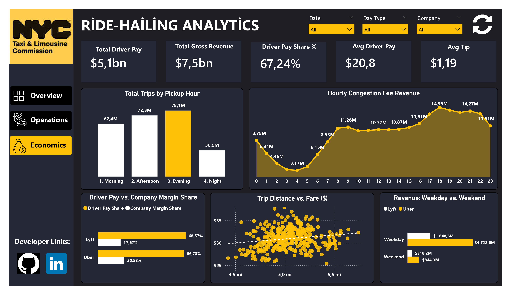

<div align="center">

# 🚖 NYC Ride-Hailing Data Engineering & Enterprise Analytics

### 243.5M+ Trip Records · OLAP Data Warehouse · Executive BI Dashboard

*From raw TLC Parquet files to an analytical warehouse and an executive dashboard: Python → Polars → DuckDB (Star Schema) → SQL Analytics → Power BI*


[Overview](#-overview) •
[Insights](#-key-business-insights) •
[Architecture](#-system-architecture) •
[Engineering](#-key-engineering-features) •
[Warehouse](#-data-warehouse-schema) •
[Dashboard](#-power-bi-dashboard) •
[Analytics](#-deep-dive-analytics) •
[Quick Start](#-quick-start)

</div>

---

## 📑 Table of Contents

- [Overview](#-overview)
- [Project Highlights](#-project-highlights)
- [Key Business Insights](#-key-business-insights)
- [System Architecture](#-system-architecture)
- [ETL Pipeline](#-etl-pipeline)
- [Key Engineering Features](#-key-engineering-features)
- [Data Warehouse Schema](#-data-warehouse-schema)
- [Power BI Dashboard](#-power-bi-dashboard)
- [Deep-Dive Analytics](#-deep-dive-analytics)
- [Technology Stack](#-technology-stack)
- [Quick Start](#-quick-start)
- [Configuration](#-configuration)
- [Repository Structure](#-repository-structure)
- [Engineering Challenges](#-engineering-challenges--solutions)
- [Roadmap](#-roadmap)
- [Author](#-author)

---

## 🎯 Overview

**NYC Ride-Hailing Data Engineering & Enterprise Analytics** is an end-to-end data engineering and analytics project that processes **243.5 Million+ High-Volume For-Hire Vehicle (HVFHV) trips** (Uber & Lyft) across New York City for the entire year of **2025**.

The pipeline ingests raw **TLC Parquet datasets**, cleans and enriches them with **Polars**, and loads them into an **OLAP Data Warehouse** built on **DuckDB** using a dimensional **Star Schema**.

Analytical insights are produced through two complementary layers:

- **Advanced SQL Analytics:** DuckDB queries (window functions, aggregations, bucketing) executed from Python and returned as Polars dataframes.
- **Power BI Executive Dashboard:** A 3-page report with a custom dark-theme UI for financial, operational, and driver-economics analysis.

The project focuses not only on processing volume, but also on **query performance, dimensional modeling, business-oriented insights, and presentation quality**.

---

## 🎬 Dashboard Preview



---

## 📌 Project Highlights

| Component | Implementation |
|---|---|
| Data Source | NYC TLC HVFHV Trip Records (Parquet) |
| Time Coverage | Full year 2025 |
| Scale | 243.5M+ trips |
| Platforms Analyzed | Uber (HV0003) · Lyft (HV0005) |
| Data Processing | Polars (vectorized transformations) |
| Analytical Engine | DuckDB (OLAP) |
| Data Model | Star Schema (`fact_trips` + 3 dimensions) |
| Query Language | SQL (CASE bucketing, aggregations, joins, window functions) |
| BI Layer | Power BI (3-page executive report) |
| UI Theme | Custom dark mode (`#16191E`) |
| Total Gross Revenue | $7.54B |

### Main Capabilities

- Sub-second analytical querying across 243.5M records.
- Vectorized cleaning and feature engineering with Polars.
- Read-only, indexed DuckDB warehouse configuration.
- Dimensional modeling with a central fact table.
- Wait-time, tipping, airport, driver-earnings, and borough analytics.
- Executive KPI reporting with a dark-themed Power BI dashboard.

---

## 💡 Key Business Insights

| # | Insight | Key Finding |
|---|---|---|
| 1 | **Market Dominance** | Uber holds **~74.5% gross revenue share ($5.57B)** vs. Lyft ($1.97B), across all NYC boroughs and airport corridors. |
| 2 | **Wait Time & Tipping** | Pickups under **2 min** get tipped on **24.21%** of trips ($1.64 avg tip); beyond 5 min, tipping probability drops to **~17.2%**. |
| 3 | **Airport Premium** | Airport pickups yield **15.1% higher gross revenue** ($80.70 vs. $70.11 on Uber) than dropoffs. |
| 4 | **Speed vs. Congestion Paradox** | **04:00–05:00** gives the highest hourly driver pay (**$76.16/hr**); afternoon peaks give the highest pay per mile (**$4.80/mi**) but lower hourly earnings due to traffic. |
| 5 | **Scale Efficiency** | DuckDB + Polars enables sub-second analytics over 243.5M records without memory bottlenecks. |

---

## 🏗️ System Architecture

The platform follows a layered, warehouse-centric architecture in which DuckDB acts as the central analytical engine.



### Architecture Layers

| Layer | Responsibility |
|---|---|
| Ingestion | Reads multi-gigabyte raw TLC HVFHV Parquet files |
| Processing | Polars cleaning, timestamp conversion, derived metrics |
| Storage | DuckDB OLAP warehouse with Star Schema |
| Analytics | High-performance SQL queries over 243.5M+ rows |
| Modeling | Power BI data model with DAX measures |
| Presentation | 3-page executive dashboard |

---

## ⚙️ ETL Pipeline



### Pipeline Execution

**1. Extraction**

Ingested multi-gigabyte raw TLC High-Volume For-Hire Vehicle (HVFHV) Parquet datasets.

**2. Transformation & Cleaning**

Polars performs fast vectorized operations: timestamp conversions, wait-time calculation (`pickup - request`), speed (`miles / hour`), and derived financial margins.

**3. Loading & Warehousing**

An optimized **Star Schema** is modeled and populated inside DuckDB, with indexing and read-only concurrency configuration.

**4. Analytics Layer**

High-performance SQL queries produce business insights and serve aggregated models to Power BI.

---

## 🌟 Key Engineering Features

<table>
<tr>
<td width="50%" valign="top">

### ⚡ Sub-Second OLAP Queries

DuckDB's columnar, vectorized engine runs analytical queries across **243.5M+ records** without memory bottlenecks.

</td>
<td width="50%" valign="top">

### 🧮 Vectorized Processing with Polars

Polars handles timestamp parsing, wait-time and speed calculations, and margin derivation at scale before loading.

</td>
</tr>

<tr>
<td width="50%" valign="top">

### 🧱 Dimensional Modeling

A Star Schema (`fact_trips` + `dim_company`, `dim_location`, `dim_date`) separates measures from descriptive context for clean, fast analytics.

</td>
<td width="50%" valign="top">

### 🔒 Read-Only Analytical Access

The warehouse is opened with `read_only=True` for analytics, enabling safe concurrent query access.

</td>
</tr>

<tr>
<td width="50%" valign="top">

### 📈 Business-Oriented SQL

Wait-time bucketing, airport trip classification, hourly driver-efficiency metrics, and borough market-share analysis.

</td>
<td width="50%" valign="top">

### 🎨 Executive Dark-Theme BI

A 3-page Power BI report with a custom dark UI (`#16191E`), KPI blocks, waterfall bridges, and dual-axis combo charts.

</td>
</tr>
</table>

---

## 🗄️ Data Warehouse Schema



### Table Overview

| Table | Type | Description |
|---|---|---|
| `fact_trips` | Fact | One row per trip: timestamps, distance, revenue, driver pay, tips, margin, congestion fee |
| `dim_company` | Dimension | Platform (Uber HV0003 / Lyft HV0005) |
| `dim_location` | Dimension | Borough, zone, and service zone |
| `dim_date` | Dimension | Month, day type, weekend flag |

---

## 📊 Power BI Dashboard

The frontend is a **3-page Executive Power BI Report** optimized for dark mode (`#16191E`) with custom accent styling.

### Page 1: Overview — Financial Performance & Market Share

KPI blocks ($7.54B Revenue, 244M Trips), Market Share Clustered Bars, Net Revenue Share Donut, Monthly Revenue Trend, and Waterfall Margin Bridge.


### Page 2: Operations — Spatial Demand & Fleet Dynamics

Top Active Zones, Service Zone Distribution, Geographic Demand, and a Dual-Axis `Demand & Wait Time` combo chart by time window.



### Page 3: Economics — Pricing & Driver Economics

`Driver Pay Share %` by company, `Hourly Congestion Fee Revenue`, `Trip Distance vs. Fare` scatter plot with trendlines, and `Weekday vs. Weekend` earnings.



---

## 🔍 Deep-Dive Analytics

The analytics module (`src/advanced_analytics.py`) executes high-performance queries directly on the 243.5M+ record DuckDB warehouse and returns results as Polars dataframes.

### Query 1: Wait Time Impact on Passenger Tipping

```python
import duckdb
import polars as pl

con = duckdb.connect("nyc_ride_hailing_2025.duckdb", read_only=True)

query_wait_vs_tip = """
    SELECT 
        CASE 
            WHEN epoch(pickup_datetime - request_datetime) / 60.0 < 2 THEN '1. Under 2 min'
            WHEN epoch(pickup_datetime - request_datetime) / 60.0 BETWEEN 2 AND 5 THEN '2. 2-5 min'
            WHEN epoch(pickup_datetime - request_datetime) / 60.0 BETWEEN 5 AND 10 THEN '3. 5-10 min'
            ELSE '4. Over 10 min'
        END AS wait_time_bucket,
        COUNT(*) AS total_trips,
        ROUND(AVG(tips), 2) AS avg_tip_amount,
        ROUND(SUM(CASE WHEN tips > 0 THEN 1 ELSE 0 END) * 100.0 / COUNT(*), 2) AS tip_percentage
    FROM fact_trips
    GROUP BY wait_time_bucket
    ORDER BY wait_time_bucket;
"""

df_wait_tip = con.sql(query_wait_vs_tip).pl()
print(df_wait_tip)
con.close()
```

| wait_time_bucket | total_trips | avg_tip_amount ($) | tip_percentage (%) |
|---|---:|---:|---:|
| 1. Under 2 min | 27,634,391 | $1.64 | 24.21% |
| 2. 2-5 min | 132,255,064 | $1.11 | 18.90% |
| 3. 5-10 min | 68,756,510 | $1.14 | 17.23% |
| 4. Over 10 min | 14,943,719 | $1.37 | 17.27% |

> 📌 **Business Takeaway:** Dispatch efficiency directly drives gratuity behavior. Pickups under 2 minutes reach a peak **24.21%** tip probability ($1.64 average tip). Beyond 5 minutes, tipping rates drop and plateau at ~17.2%.

---

### Query 2: Airport Trip Profitability (JFK & LaGuardia)

```python
import duckdb
import polars as pl

con = duckdb.connect("nyc_ride_hailing_2025.duckdb", read_only=True)

query_airports = """
    SELECT 
        company_id,
        CASE 
            WHEN PULocationID IN (132, 138) THEN 'Airport Pickup'
            WHEN DOLocationID IN (132, 138) THEN 'Airport Dropoff'
            ELSE 'Standard Trip'
        END AS airport_trip_type,
        COUNT(*) AS total_trips,
        ROUND(AVG(total_gross_revenue), 2) AS avg_gross_revenue,
        ROUND(AVG(company_margin), 2) AS avg_company_margin,
        ROUND(AVG(driver_pay), 2) AS avg_driver_pay
    FROM fact_trips
    WHERE PULocationID IN (132, 138) OR DOLocationID IN (132, 138)
    GROUP BY company_id, airport_trip_type
    ORDER BY total_trips DESC;
"""

df_airports = con.sql(query_airports).pl()
print(df_airports)
con.close()
```

| company_id | airport_trip_type | total_trips | avg_gross_revenue ($) | avg_company_margin ($) | avg_driver_pay ($) |
|---|---|---:|---:|---:|---:|
| HV0003 (Uber) | Airport Dropoff | 7,511,410 | $70.11 | $19.01 | $40.66 |
| HV0003 (Uber) | Airport Pickup | 6,515,668 | $80.70 | $18.38 | $49.67 |
| HV0005 (Lyft) | Airport Dropoff | 2,744,378 | $62.49 | $13.60 | $38.67 |
| HV0005 (Lyft) | Airport Pickup | 2,476,365 | $71.92 | $11.81 | $48.09 |

> 📌 **Business Takeaway:** Airport pickups generate **15.1% higher gross revenue** than dropoffs due to demand surges and airport fees. Uber commands superior unit economics ($18.38–$19.01 net margin per airport trip) versus Lyft ($11.81–$13.60).

---

### Query 3: Driver Earnings & Efficiency (Speed vs. Congestion Paradox)

```python
import duckdb
import polars as pl

con = duckdb.connect("nyc_ride_hailing_2025.duckdb", read_only=True)

query_driver_efficiency = """
    SELECT 
        HOUR(pickup_datetime) AS pickup_hour,
        COUNT(*) AS total_trips,
        ROUND(AVG(driver_pay), 2) AS avg_driver_pay,
        ROUND(SUM(driver_pay) / (SUM(epoch(dropoff_datetime - pickup_datetime)) / 3600.0), 2) AS driver_pay_per_hour_worked,
        ROUND(SUM(driver_pay) / SUM(trip_miles), 2) AS driver_pay_per_mile
    FROM fact_trips
    GROUP BY pickup_hour
    ORDER BY driver_pay_per_hour_worked DESC;
"""

df_driver_eff = con.sql(query_driver_efficiency).pl()
print(df_driver_eff)
con.close()
```

**Selected windows:**

| pickup_hour | total_trips | avg_driver_pay ($) | driver_pay_per_hour_worked ($/hr) |
|---|---:|---:|---:|
| 04:00 | 3,743,159 | $23.01 | $76.16 |
| 05:00 | 4,446,709 | $23.13 | $73.76 |
| 03:00 | 3,540,262 | $20.48 | $71.46 |
| 18:00 (Peak) | 14,281,332 | $20.29 | $60.42 |
| 17:00 (Peak) | 13,816,750 | $21.43 | $58.67 |

> 📌 **Business Takeaway:** Early-morning shifts (04:00–05:00) maximize time efficiency (**$76.16/hr**) because clear roads let drivers cover more distance per hour. Peak hours yield the highest rate per distance (**$4.80/mi**), but Manhattan congestion reduces net hourly earnings to ~$58.67/hr.

---

### Query 4: Borough Market Share Dispersion

```python
import duckdb
import polars as pl

con = duckdb.connect("nyc_ride_hailing_2025.duckdb", read_only=True)

query_borough_share = """
    SELECT 
        loc.borough,
        fact.company_id,
        COUNT(*) AS total_trips,
        ROUND(SUM(fact.total_gross_revenue), 2) AS total_gross_revenue,
        ROUND(AVG(fact.trip_miles), 2) AS avg_trip_miles
    FROM fact_trips fact
    JOIN dim_location loc ON fact.PULocationID = loc.location_id
    GROUP BY loc.borough, fact.company_id
    ORDER BY loc.borough, total_trips DESC;
"""

df_borough_share = con.sql(query_borough_share).pl()
print(df_borough_share)
con.close()
```

| borough | company_id | total_trips | total_gross_revenue ($) | avg_trip_miles |
|---|---|---:|---:|---:|
| Bronx | HV0003 (Uber) | 23,680,225 | $491,180,000 | 4.40 mi |
| Bronx | HV0005 (Lyft) | 7,725,806 | $162,950,000 | 4.14 mi |
| Brooklyn | HV0003 (Uber) | 46,402,943 | $1,135,400,000 | 4.23 mi |
| Brooklyn | HV0005 (Lyft) | 18,909,401 | $459,540,000 | 4.01 mi |
| Queens | HV0003 (Uber) | 38,341,799 | $1,255,800,000 | 6.35 mi |
| Queens | HV0005 (Lyft) | 14,549,653 | $454,930,000 | 6.13 mi |
| Staten Island | HV0003 (Uber) | 2,927,924 | $71,005,000 | 5.43 mi |
| Staten Island | HV0005 (Lyft) | 881,957 | $20,140,000 | 4.50 mi |

> 📌 **Business Takeaway:** Uber maintains a consistent ~75% trip-volume and revenue dominance across all 5 NYC boroughs. Queens has the highest distance per trip (6.13–6.35 mi) due to airport logistics, making it the most revenue-dense borough outside Manhattan.

---

## 🧰 Technology Stack

| Layer | Technology |
|---|---|
| Programming Language | Python |
| Data Source | NYC TLC HVFHV Parquet Datasets |
| Data Processing | Polars |
| Analytical Engine | DuckDB |
| Data Model | Star Schema (OLAP) |
| Query Language | SQL |
| BI & Visualization | Power BI (DAX) |
| UI Theme | Custom Dark Mode |
| Version Control | Git / GitHub |

---

## 🚀 Quick Start

### Prerequisites

- Python 3.10+
- Git
- Power BI Desktop (for the `.pbix` report)

### 1. Clone the Repository

```bash
git clone https://github.com/nihatrza/nyc-ride-hailing-analytics.git

cd nyc-ride-hailing-analytics
```

### 2. Set Up the Python Environment

```bash
python3 -m venv .venv

source .venv/bin/activate

pip install duckdb polars
```

### 3. Run the Analytics Script

```bash
python src/advanced_analytics.py
```

### 4. Open the Power BI Dashboard

Open `power_bi/nyc_ride_hailing_2025.pbix` in Power BI Desktop to inspect measures, visuals, and interactive filters.

> The raw TLC Parquet files and the generated DuckDB warehouse are large and are not committed to GitHub. Run the ETL scripts in `src/` to rebuild them locally.

---

## 🔧 Configuration

| Configuration | Location | Description |
|---|---|---|
| ETL pipeline | `src/etl_pipeline.py` | Polars & DuckDB data pipeline |
| Warehouse setup | `src/data_warehouse_setup.py` | Schema generation & table population |
| Analytics | `src/advanced_analytics.py` | Deep-dive DuckDB SQL queries |
| Warehouse file | `nyc_ride_hailing_2025.duckdb` | Generated DuckDB database |
| Dashboard | `power_bi/nyc_ride_hailing_2025.pbix` | Power BI report |
| Dashboard docs | `power_bi/README.md` | Report documentation |
| Screenshots | `assets/` | Dashboard page previews |

---

## 📁 Repository Structure

```text
nyc-ride-hailing-analytics/
│
├── assets/
│   ├── page1_overview.png
│   ├── page2_operations.png
│   └── page3_economics.png
│
├── src/
│   ├── etl_pipeline.py            # Polars & DuckDB data pipeline
│   ├── data_warehouse_setup.py    # Schema generation & table population
│   └── advanced_analytics.py      # Deep-dive DuckDB SQL analytical queries
│
├── power_bi/
│   ├── README.md                  # Report documentation
│   └── nyc_ride_hailing_2025.pbix # Complete Power BI dashboard file
│
├── .gitignore
├── LICENSE
└── README.md
```

---

## 🧩 Engineering Challenges & Solutions

| Challenge | Engineering Approach |
|---|---|
| Processing 243.5M+ records | Polars vectorized transformations |
| Memory bottlenecks at scale | DuckDB columnar OLAP engine |
| Fast analytical querying | Star Schema with indexing |
| Safe concurrent analytics | Read-only DuckDB connections |
| Wait-time & speed derivation | Computed during Polars transformation |
| Business-ready reporting | Power BI data model with DAX measures |
| Executive presentation quality | Custom 3-page dark-theme dashboard |

---

## 🗺️ Roadmap

- [x] Raw TLC Parquet ingestion
- [x] Polars cleaning & feature engineering
- [x] DuckDB OLAP warehouse
- [x] Star Schema (fact + dimensions)
- [x] Advanced SQL analytics (4 deep-dive queries)
- [x] 3-page Power BI executive dashboard
- [x] GitHub repository and project documentation
- [ ] Automated data quality checks
- [ ] Automated integration testing
- [ ] CI/CD with GitHub Actions
- [ ] Interactive web dashboard (Streamlit)

---

## 👤 Author

**Nihat Rzaguluzada**

Data Analyst & Engineer | Information Technologies Undergraduate

- **Education:** Azerbaijan State University of Economics (UNEC)
- **Certifications:** DataCamp Associate Data Analyst · freeCodeCamp Data Analysis with Python

[](https://github.com/nihatrza)

[](https://www.linkedin.com/in/nihat-rzaguluzade/)

---

<div align="center">

**Built with Python, DuckDB, and a passion for Data Engineering.**

⭐ If you find this project interesting, consider giving it a star!

</div>
